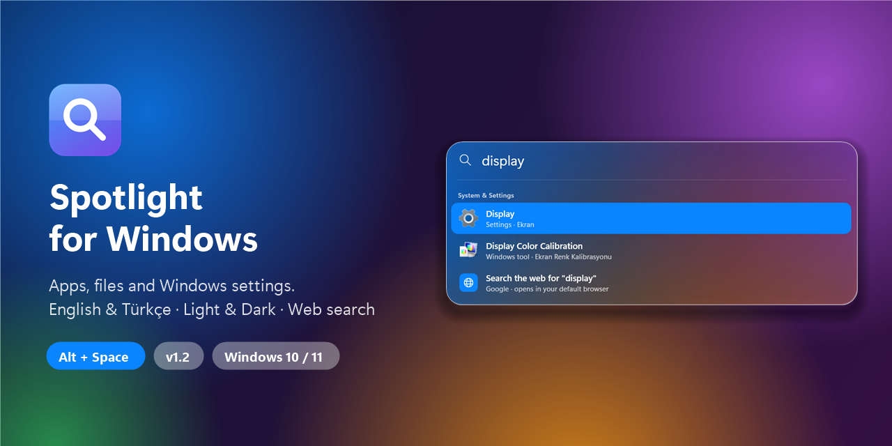
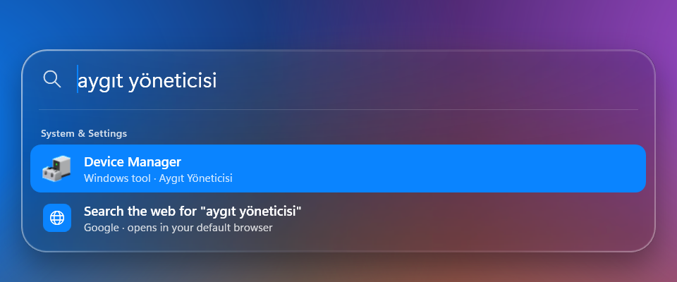
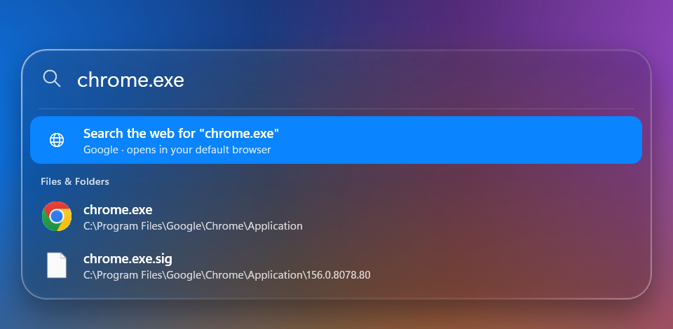
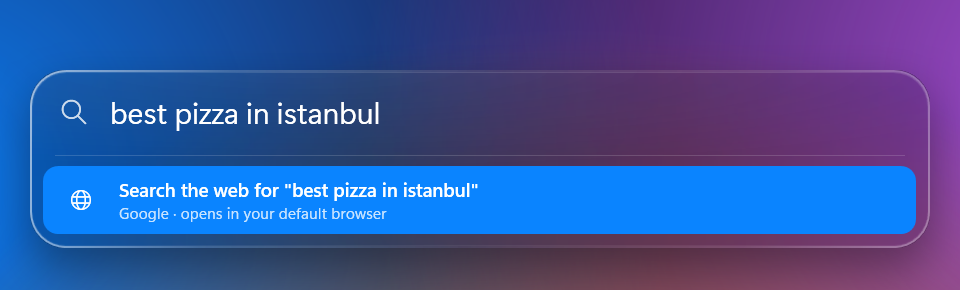
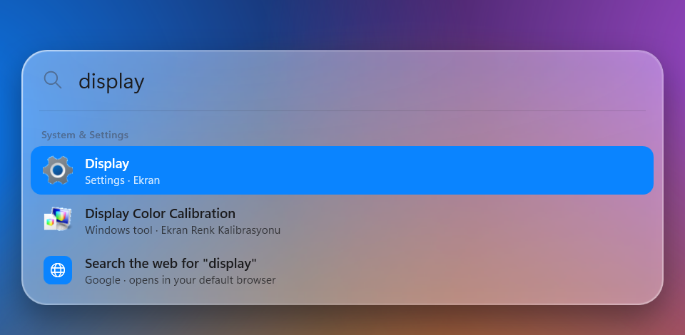
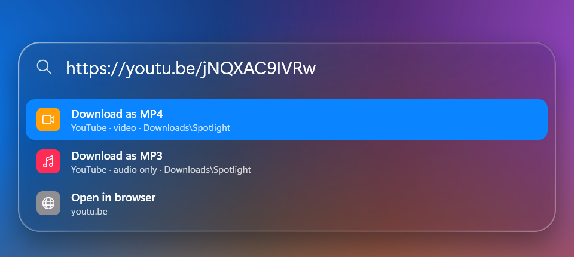
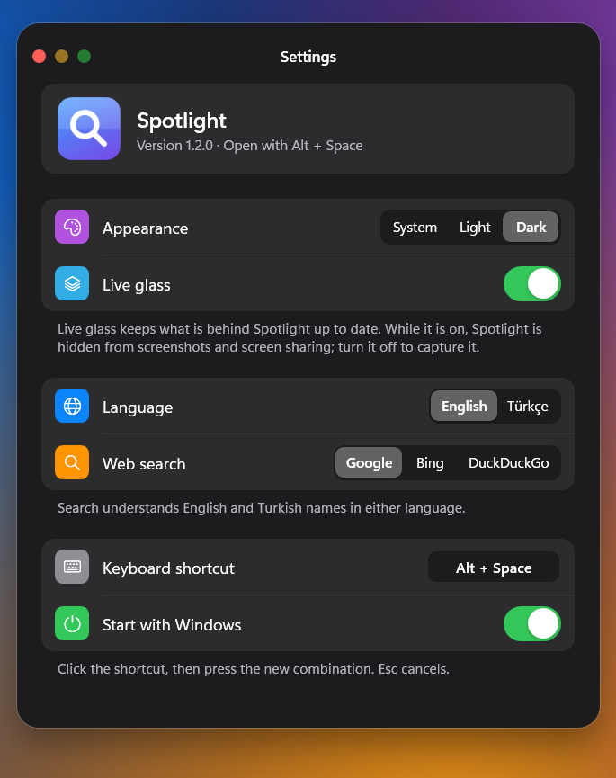

<p align="center">
  
</p>

<p align="center">
  <a href="https://github.com/mondieuu/spotlight-for-windows/releases/latest"><b>⬇ Download SpotlightSetup.exe</b></a>
  &nbsp;·&nbsp; Windows 10 / 11 &nbsp;·&nbsp; v1.2 &nbsp;·&nbsp; English · <a href="#türkçe">Türkçe</a>
</p>

---

**Spotlight for Windows** brings the macOS Spotlight experience to Windows.
Press **Alt + Space** and start typing: apps, every file on your PC and Windows settings appear instantly.
If nothing matches, one press of Enter searches the web in your default browser.
The Liquid Glass design, spring animations, light and dark themes, and English/Turkish support make Windows feel like a Mac.

## Features

| | |
|---|---|
| 🔎 **App search** | Every app in the Start menu, shown with its real icon. The apps you open most rise to the top. |
| 📁 **Search every file** | All fixed drives are indexed (the first scan takes ~20 s). Type a file name with its extension (`report.xlsx`, `chrome.exe`) and every result shows **where the file lives**. |
| 🌐 **Web search** | Results come in this order: **apps → web search → files**. If no app matches (e.g. `youtube`), Enter searches Google, Bing or DuckDuckGo in your default browser. |
| 🌍 **English & Turkish** | `device manager` and `aygıt yöneticisi` find the same tool. ~170 Windows tools, settings pages and folders work in both languages. |
| ✍️ **Typo tolerant** | `devise manger` → Device Manager. Turkish characters are optional: `sozlesme` = `sözleşme`. |
| ⚙️ **Windows settings** | Wi-Fi, Bluetooth, Display, Windows Update, Dark mode… each one opens the right settings page directly. |
| 📂 **Paste a path** | Paste `C:\Windows\notepad.exe` or a folder path to open it in File Explorer. |
| 🎵 **MP3 / MP4 converter** | Paste a YouTube or Instagram link and save it as an MP4 video or an MP3 audio file with one key. |
| 🌗 **Light & dark themes** | Pick Light, Dark or follow Windows in **Settings**. Changes apply instantly. |
| 🪟 **Clear Liquid Glass** | Crystal-clear glass that shows what is really behind it, kept live while open, with lens refraction and light dispersion at the edges. |
| 🫧 **Fluid motion** | Apple-style spring animations: interruptible, no bounce, and calmer when Windows "Animation effects" is off. |
| 🧹 **Clean uninstall** | Uninstalling removes the program, index, settings, shortcuts and registry entries. Nothing is left behind. |

## Screenshots

<table>
  <tr>
    <td width="50%"><br><sub><b>Bilingual:</b> type the Turkish name, get Device Manager</sub></td>
    <td width="50%"><br><sub><b>File search:</b> the location is shown under the name</sub></td>
  </tr>
  <tr>
    <td><br><sub><b>Web fallback:</b> nothing found? Search the web</sub></td>
    <td><br><sub><b>Light theme:</b> Windows settings and tools</sub></td>
  </tr>
  <tr>
    <td><br><sub><b>Converter:</b> paste a link, choose MP4 or MP3</sub></td>
    <td><br><sub><b>Settings:</b> theme, language and web search engine</sub></td>
  </tr>
</table>

## Install

1. Download **`SpotlightSetup.exe`** from the [Releases](https://github.com/mondieuu/spotlight-for-windows/releases/latest) page.
2. Run it. Optionally switch the installer to **TR** in the top-right corner, tick **Start with Windows** and/or **Add a desktop shortcut**, then click **Install**.
3. Click **Open Spotlight**. From now on, **Alt + Space** opens it from anywhere.

- **No administrator rights** are needed. Spotlight installs for your user account only (`%LOCALAPPDATA%\Programs\Spotlight`).
- **No .NET install** is needed; everything is inside the single file.
- **To update**, run the setup file of the new version and click **Update**.

> **"Windows protected your PC" warning:** the setup file is not digitally signed, so SmartScreen may show this. Click **More info → Run anyway** to continue.

## User guide

### Open and close
| Shortcut | What it does |
|---|---|
| **Alt + Space** | Opens / closes Spotlight. If another app already uses Alt+Space, **Ctrl + Space** is used instead; the tray icon tooltip shows which one. |
| **Esc** | Closes it. Clicking anywhere else also closes it. |

### Navigate the results
| Shortcut | What it does |
|---|---|
| **↑ / ↓** | Moves between results (section headers are skipped). |
| **Enter** | Opens the selected result: launches the app, opens the file, goes to the settings page or searches the web. |
| **Ctrl + Enter** | Shows the file's **location**, selected in File Explorer (⌘↵ on macOS). |
| **Mouse** | Click a result to open it. |

### What can you type?
| You type | You get |
|---|---|
| `chrome`, `note`, `calc` | Apps; initials work too (`vsc` → Visual Studio Code) |
| `device manager`, `aygıt yöneticisi`, `regedit` | Windows tools, in either language |
| `wifi`, `bluetooth`, `dark mode`, `update` | The matching Windows Settings page |
| `driver`, `wallpaper`, `password` | Tools and settings found by keyword |
| `chrome.exe`, `invoice.pdf`, `report.xlsx` | Files and folders (type the extension), with their location under the name |
| `C:\Users`, `%APPDATA%`, `~\Downloads` | Opens that folder or file in File Explorer |
| `https://youtube.com/…`, `https://instagram.com/…` | **Download as MP4**, **Download as MP3**, **Open in browser** |
| `spotlight settings`, `theme`, `language` | Opens Spotlight's own Settings |
| `youtube`, `weather istanbul` | **Search the web for "…"** right after any matching apps |

### Settings
Open the Settings window from the tray menu (**Settings…**) or by typing `settings` in Spotlight. Every change applies immediately:

| Setting | Options |
|---|---|
| **Theme** | System (follows Windows) · Light · Dark |
| **Display language** | English · Türkçe. Search understands both languages either way. |
| **Live glass** | On / Off. Keeps what is behind the glass up to date. While it is on, Spotlight is hidden from screenshots and screen sharing. |
| **Web search** | Google · Bing · DuckDuckGo |
| **Keyboard shortcut** | Click it and press any combination, e.g. Ctrl + Shift + Space |
| **Start with Windows** | On / Off |

### MP3 / MP4 converter
1. Paste a YouTube or Instagram link into Spotlight.
2. Choose **Download as MP4** (video) or **Download as MP3** (audio only) and press Enter.
3. Progress appears in the row, and a notification arrives when the download is done. Files are saved to **Downloads\Spotlight**.

The first time you use it, the conversion tools ([yt-dlp](https://github.com/yt-dlp/yt-dlp) and [FFmpeg](https://github.com/yt-dlp/FFmpeg-Builds), ~120 MB) are downloaded once from their official GitHub releases. yt-dlp then updates itself weekly.

> Only download content you have the right to download. YouTube's and Instagram's terms of service apply.

### Tray menu
**Right-click** the Spotlight icon on the right side of the taskbar:
- **Open:** opens Spotlight (double-clicking the icon does the same).
- **Settings…:** theme, language, web search engine, start with Windows.
- **Downloads folder:** shows your downloaded MP3/MP4 files.
- **Start with Windows:** starts Spotlight in the background when you sign in.
- **Uninstall Spotlight…:** opens the uninstaller.
- **Quit**

### About the file index
- All fixed drives are scanned in the background at low priority. The index is saved to disk, so it is ready instantly on the next start.
- Files you add or delete while Spotlight runs show up right away, and a full rescan runs every 3 hours.
- These folders are skipped for speed:
  - Windows component stores (WinSxS, Installer…)
  - Temp and browser caches
  - Recycle Bin
  - `node_modules` and `.git`
- System libraries (`.dll`, `.mui`…) only appear when you type the extension, e.g. `shell32.dll`.

## Uninstall

Go to **Settings › Apps › Installed apps › Spotlight › Uninstall**, or choose **Uninstall Spotlight…** from the tray menu.

Uninstalling removes **all** of the following:

- The program folder: `%LOCALAPPDATA%\Programs\Spotlight`
- The file index, settings, usage counts and yt-dlp/FFmpeg: `%LOCALAPPDATA%\Spotlight`
- .NET's temporary files: `%TEMP%\.net\Spotlight`
- The Start menu and desktop shortcuts
- The "Start with Windows" and "Installed apps" registry entries

Your downloaded MP3/MP4 files (**Downloads\Spotlight**) are yours. They are only deleted if you tick that box in the uninstaller.

## Privacy

Spotlight runs entirely on your PC. Searches, file names and usage data are **never sent anywhere**, and there is no telemetry. It only goes online when you ask it to:

- A web search you choose sends your query to the search engine you picked, in your browser.
- The first use of the converter downloads its tools.
- A download you start fetches that video or audio.

## Build from source

You need Windows 10/11 (64-bit) and the [.NET 10 SDK](https://dotnet.microsoft.com/download).

```bash
git clone https://github.com/mondieuu/spotlight-for-windows.git
cd spotlight-for-windows
dotnet run -c Release
```

To build the single-file installer:

```bash
dotnet publish -c Release -r win-x64 -o publish
```

Rename `publish\Spotlight.exe` to `SpotlightSetup.exe`: an exe with "Setup" in its name opens as the installer.

| File | Purpose |
|---|---|
| `SearchWindow.xaml(.cs)` | Search window, results, keyboard, web fallback |
| `SettingsWindow.cs` · `Settings.cs` | Settings window, preferences and English/Turkish text |
| `Backdrop.cs` | Liquid Glass background: blur, vibrancy, edge refraction |
| `Spring.cs` | Apple-style spring animations (response + damping) |
| `AppIndex.cs` · `Catalog.cs` | App index and bilingual Windows catalog; scoring and typo tolerance |
| `FileIndex.cs` | Whole-disk file index, live watching, parallel search |
| `Converter.cs` | MP3/MP4 via yt-dlp + FFmpeg |
| `Installer.cs` · `SetupWindow.cs` | Install and trace-free uninstall |

## License and notice

Spotlight for Windows is released under the [MIT](LICENSE) license. yt-dlp ([Unlicense](https://github.com/yt-dlp/yt-dlp/blob/master/LICENSE)) and FFmpeg ([GPL](https://ffmpeg.org/legal.html)) are not distributed with the app; they are downloaded from their official sources on first use.

This is an independent project, **not affiliated with or endorsed by Apple Inc.** Spotlight, macOS and Apple are trademarks of Apple Inc. Windows is a trademark of Microsoft Corporation.

---

<a id="türkçe"></a>

## Türkçe

**Spotlight for Windows**, macOS'taki Spotlight deneyimini Windows'a getirir. **Alt + Space**'e bas ve yazmaya başla.

- **Uygulamalar, dosyalar ve Windows ayarları tek yerde.** Bilgisayardaki tüm dosyalar dizinlenir; her sonucun altında dosyanın konumu yazar.
- **Sonuç sırası: uygulamalar → web araması → dosyalar.** Eşleşen uygulama yoksa (ör. `youtube`) Enter varsayılan tarayıcında arar. Dosyalar uzantıyla yazınca listelenir (`rapor.xlsx`).
- **İngilizce ve Türkçe:** `device manager` da yazsan `aygıt yöneticisi` de aynı aracı bulursun. Yaklaşık 170 Windows aracı ve ayarı iki dilde bulunur. Yazım hataları tolere edilir.
- **Disk yolu yapıştır,** Dosya Gezgini'nde açılsın. **YouTube veya Instagram bağlantısı yapıştır,** MP4 ya da MP3 olarak indir.
- **Ayarlar:** tepsi menüsünden **Ayarlar…** ile ya da Spotlight'a `ayarlar`/`tema` yazarak açılır.
  - Tema: Sistem / Açık / Koyu
  - Canlı cam: camın arkasındakini güncel tutar (ekran paylaşırken kapatılabilir)
  - Arayüz dili: English / Türkçe
  - Web arama motoru
  - Windows ile başlatma
- **Kısayollar:**

  | Tuş | Ne yapar |
  |---|---|
  | `↑/↓` | Sonuçlar arasında gezinir |
  | `Enter` | Seçili sonucu açar |
  | `Ctrl+Enter` | Dosyayı Dosya Gezgini'nde seçili gösterir |
  | `Esc` | Kapatır |

- **Kurulum:** [Releases](https://github.com/mondieuu/spotlight-for-windows/releases/latest) sayfasından `SpotlightSetup.exe`'yi indir. Kurulum penceresinin sağ üstündeki **TR** düğmesiyle Türkçeye geçebilirsin. Yönetici izni gerekmez. Dosya imzasız olduğu için SmartScreen uyarı verirse **Ek bilgi → Yine de çalıştır**'a bas.
- **Kaldırma:** **Ayarlar › Uygulamalar › Yüklü uygulamalar › Spotlight** ya da tepsi menüsü. Program, dizin, ayarlar, araçlar, kısayollar ve kayıt defteri girdileri tamamen silinir. İndirdiğin dosyalar sen işaretlemedikçe kalır.
- **Gizlilik:** Her şey bilgisayarında çalışır, telemetri yoktur.

Apple Inc. ile bağlantısı yoktur. Spotlight ve macOS, Apple Inc.'in ticari markalarıdır.
