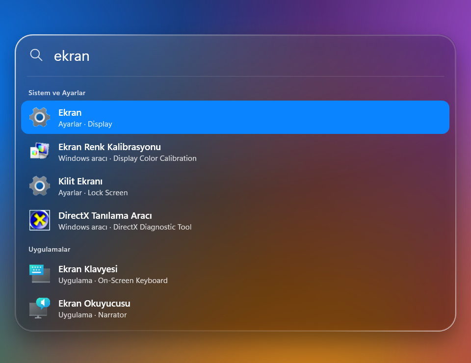

<p align="center">
  
</p>

<p align="center">
  <a href="https://github.com/mondieuu/spotlight-for-windows/releases/latest"><b>⬇ SpotlightSetup.exe'yi indir</b></a>
  &nbsp;·&nbsp; Windows 10 / 11 &nbsp;·&nbsp; v1.0 &nbsp;·&nbsp; <a href="#english">English</a>
</p>

---

**Spotlight for Windows**, macOS'taki Spotlight deneyimini Windows'a getiren hızlı bir arama çubuğudur.
**Alt + Space**'e bas, yazmaya başla: uygulamalar, bilgisayardaki tüm dosyalar ve Windows ayarları anında karşında.
Liquid Glass tasarımı, yaylı animasyonları ve Türkçe/İngilizce aramasıyla Windows'ta Mac gibi hissettirir.

## Özellikler

| | |
|---|---|
| 🔎 **Uygulama arama** | Başlat menüsündeki tüm uygulamalar, gerçek simgeleriyle. Sık açtıkların üste çıkar. |
| 📁 **Tüm diskte dosya arama** | Bütün sabit diskler dizinlenir (ilk tarama ~20 sn). Her sonucun altında **nerede olduğu** yazar. |
| 🌍 **Türkçe & English** | `device manager` da yazsan `aygıt yöneticisi` de yazsan aynı sonuç. ~170 Windows aracı, ayar sayfası ve klasör iki dilde. |
| ✍️ **Yazım hatası toleransı** | `devise manger` → Aygıt Yöneticisi. Türkçe karakter gerekmez: `sozlesme` = `sözleşme`. |
| ⚙️ **Windows ayarları** | Wi-Fi, Bluetooth, Ekran, Windows Update, Karanlık mod… Doğrudan ilgili sayfayı açar. |
| 📂 **Yol yapıştır** | `C:\Windows\notepad.exe` ya da bir klasör yolu yapıştır → Dosya Gezgini'nde açılır. |
| 🎵 **MP3 / MP4 dönüştürücü** | YouTube veya Instagram bağlantısı yapıştır → tek tuşla MP4 video ya da MP3 ses olarak indir. |
| 🪟 **Liquid Glass** | Arkasını bulanık gösteren, kenarlarında ışığı büken cam; açık/koyu temaya uyar. |
| 🫧 **Akıcı hareket** | Apple'ın yay animasyonları: kesilebilir, sıçramasız, "Animasyon efektleri" kapalıysa sade. |
| 🧹 **İz bırakmadan kaldırma** | Kaldırınca program, dizin, ayarlar, kısayollar ve kayıt defteri girdileri tamamen silinir. |

## Ekran görüntüleri

<table>
  <tr>
    <td width="50%"><br><sub><b>İki dilli:</b> "device manager" → Aygıt Yöneticisi</sub></td>
    <td width="50%"><br><sub><b>Dosya arama:</b> konumu adın altında</sub></td>
  </tr>
  <tr>
    <td><br><sub><b>Dönüştürücü:</b> bağlantıyı yapıştır, MP4 ya da MP3 seç</sub></td>
    <td><br><sub><b>Ayarlar ve araçlar:</b> "ekran" → Display, Lock Screen…</sub></td>
  </tr>
</table>

## Kurulum

1. [Releases](https://github.com/mondieuu/spotlight-for-windows/releases/latest) sayfasından **`SpotlightSetup.exe`**'yi indir.
2. Çift tıkla. İstersen **Windows ile başlat** ve **Masaüstüne kısayol ekle** seçeneklerini işaretle, **Kur**'a bas.
3. **Spotlight'ı Aç**'a bas. Artık her yerde **Alt + Space** ile açılır.

- Yönetici izni **gerekmez**; yalnızca senin kullanıcı hesabına kurulur (`%LOCALAPPDATA%\Programs\Spotlight`).
- .NET kurmana gerek yok, her şey tek dosyanın içinde.
- Güncellemek için yeni sürümün kurulum dosyasını çalıştırman yeterli ("Güncelle").

> **"Windows bilgisayarınızı korudu" uyarısı:** Kurulum dosyası dijital olarak imzalı olmadığı için SmartScreen bu uyarıyı gösterebilir. **Ek bilgi → Yine de çalıştır** ile devam edebilirsin.

## Kullanım kılavuzu

### Açma ve kapatma
| Kısayol | Ne yapar |
|---|---|
| **Alt + Space** | Spotlight'ı açar / kapatır. (Alt+Space başka bir programdaysa **Ctrl + Space** kullanılır; tepsi simgesinin üzerinde yazar.) |
| **Esc** | Kapatır. Başka bir yere tıklamak da kapatır. |

### Sonuçlarda gezinme
| Kısayol | Ne yapar |
|---|---|
| **↑ / ↓** | Sonuçlar arasında gezinir (başlıklar atlanır). |
| **Enter** | Seçili sonucu açar: uygulamayı başlatır, dosyayı açar, ayar sayfasına gider. |
| **Ctrl + Enter** | Dosyanın **konumunu** Dosya Gezgini'nde seçili gösterir (macOS'taki ⌘↵). |
| **Fare** | Tıklayınca açar. |

### Ne yazabilirsin?
| Yazdığın | Sonuç |
|---|---|
| `chrome`, `not`, `hesap` | Uygulamalar (baş harfler de olur: `vsc` → Visual Studio Code) |
| `device manager`, `aygıt yöneticisi`, `regedit` | Windows araçları — iki dilde |
| `wifi`, `bluetooth`, `dark mode`, `güncelleme` | Ayarlar'ın ilgili sayfası |
| `driver`, `wallpaper`, `şifre` | Anahtar kelimeyle bulunan araç/ayar |
| `chrome.exe`, `fatura`, `rapor.xlsx` | Dosya ve klasörler (sonucun altında konumu) |
| `C:\Users`, `%APPDATA%`, `~\Downloads` | O klasörü / dosyayı Dosya Gezgini'nde açar |
| `https://youtube.com/…`, `https://instagram.com/…` | **MP4 olarak indir**, **MP3 olarak indir**, **Tarayıcıda aç** |

### MP3 / MP4 dönüştürücü
1. YouTube ya da Instagram bağlantısını Spotlight'a yapıştır.
2. **MP4 olarak indir** (video) ya da **MP3 olarak indir** (yalnızca ses) seçip Enter'a bas.
3. İlerleme satırın içinde görünür; bitince bildirim gelir. Dosyalar **İndirilenler\Spotlight** klasörüne kaydedilir.

İlk kullanımda dönüştürme araçları ([yt-dlp](https://github.com/yt-dlp/yt-dlp) ve [FFmpeg](https://github.com/yt-dlp/FFmpeg-Builds), ~120 MB) resmi GitHub sürümlerinden bir kez indirilir. yt-dlp haftada bir kendini günceller.

> Yalnızca indirme hakkına sahip olduğun içerikleri indir. YouTube ve Instagram'ın kullanım koşulları geçerlidir.

### Tepsi menüsü
Görev çubuğunun sağındaki Spotlight simgesine **sağ tıkla**:
- **Aç** — Spotlight'ı açar (çift tıklamak da açar)
- **İndirilenler klasörü** — indirilen MP3/MP4'leri gösterir
- **Windows ile başlat** — açılışta arka planda başlasın mı
- **Spotlight'ı kaldır…** — kaldırma penceresini açar
- **Çıkış**

### Dosya dizini hakkında
- Tüm sabit diskler arka planda düşük öncelikle taranır; dizin diske kaydedilir, sonraki açılışlarda anında hazırdır.
- Uygulama açıkken eklenen/silinen dosyalar anında yansır; ayrıca 3 saatte bir yeniden taranır.
- Hız için şu klasörler taranmaz: Windows'un yedek klasörleri (WinSxS, Installer…), Temp ve tarayıcı önbellekleri, Geri Dönüşüm Kutusu, `node_modules`, `.git`.
- Sistem kitaplıkları (`.dll`, `.mui`…) yalnızca uzantıyı yazınca gösterilir: `shell32.dll`.

## Kaldırma

**Ayarlar › Uygulamalar › Yüklü uygulamalar › Spotlight › Kaldır** — ya da tepsi menüsünden **Spotlight'ı kaldır…**

Kaldırınca şunların **hepsi** silinir:

- Program klasörü — `%LOCALAPPDATA%\Programs\Spotlight`
- Dosya dizini, kullanım sayıları, yt-dlp/FFmpeg — `%LOCALAPPDATA%\Spotlight`
- .NET'in geçici dosyaları — `%TEMP%\.net\Spotlight`
- Başlat menüsü ve masaüstü kısayolları
- "Windows ile başlat" ve "Uygulamalar" kayıt defteri girdileri

İndirdiğin MP3/MP4'ler (**İndirilenler\Spotlight**) senin dosyaların; yalnızca kaldırma penceresinde işaretlersen silinir.

## Gizlilik

Spotlight tamamen bilgisayarında çalışır. Arama geçmişi, dosya adları ya da kullanım bilgisi **hiçbir yere gönderilmez**; telemetri yoktur. İnternete yalnızca şu durumlarda bağlanır: dönüştürme araçlarını ilk kez indirirken ve senin başlattığın MP3/MP4 indirmelerinde.

## Kaynaktan derleme

Gerekenler: Windows 10/11 (64 bit) ve [.NET 10 SDK](https://dotnet.microsoft.com/download).

```bash
git clone https://github.com/mondieuu/spotlight-for-windows.git
cd spotlight-for-windows
dotnet run -c Release
```

Tek dosyalık kurulum exe'si üretmek için:

```bash
dotnet publish -c Release -r win-x64 -o publish
```

Çıkan `publish\Spotlight.exe` dosyasının adını `SpotlightSetup.exe` yap: adında "Setup" geçen exe kurulum penceresiyle açılır.

| Dosya | Görevi |
|---|---|
| `SearchWindow.xaml(.cs)` | Arama penceresi, sonuçlar, klavye |
| `Backdrop.cs` | Liquid Glass zemini: bulanıklık, canlılık, kenar kırılması |
| `Spring.cs` | Apple tarzı yay animasyonları (tepki + sönüm) |
| `AppIndex.cs` · `Catalog.cs` | Uygulama dizini ve iki dilli Windows kataloğu, puanlama, yazım hatası toleransı |
| `FileIndex.cs` | Tüm diskte dosya dizini, canlı izleme, paralel arama |
| `Converter.cs` | yt-dlp + FFmpeg ile MP3/MP4 |
| `Installer.cs` · `SetupWindow.cs` | Kurulum ve iz bırakmadan kaldırma |

## Lisans ve bildirim

[MIT](LICENSE). yt-dlp ([Unlicense](https://github.com/yt-dlp/yt-dlp/blob/master/LICENSE)) ve FFmpeg ([GPL](https://ffmpeg.org/legal.html)) programla birlikte dağıtılmaz; ilk kullanımda resmi kaynaklarından indirilir.

Bu proje bağımsızdır; **Apple Inc. ile hiçbir bağlantısı yoktur** ve Apple tarafından onaylanmamıştır. Spotlight, macOS ve Apple, Apple Inc.'in ticari markalarıdır. Windows, Microsoft Corporation'ın ticari markasıdır.

---

<a id="english"></a>

## English

**Spotlight for Windows** brings a macOS-style Spotlight search bar to Windows. Press **Alt + Space** and start typing.

- **Apps, files and Windows settings** in one place. Every file on your fixed drives is indexed, and each result shows its location.
- **Bilingual (Turkish & English):** `device manager` and `aygıt yöneticisi` both find Device Manager. About 170 Windows tools, settings pages and folders are covered, and typos are tolerated (`devise manger`).
- **Paste a path** to open it in File Explorer. **Paste a YouTube/Instagram link** to download it as **MP4 or MP3** (yt-dlp + FFmpeg are fetched once, on first use).
- **Liquid Glass** design with Apple-style spring animations. Respects light/dark mode and the "Animation effects" setting.
- **Keys:** `↑/↓` move · `Enter` open · `Ctrl+Enter` show in File Explorer · `Esc` close.
- **Install:** download `SpotlightSetup.exe` from [Releases](https://github.com/mondieuu/spotlight-for-windows/releases/latest). No admin rights are needed; it installs per user. SmartScreen may warn because the file is unsigned: choose *More info → Run anyway*.
- **Uninstall:** go to *Settings › Apps › Installed apps › Spotlight*, or use the tray menu. This removes everything: the program, index, settings, tools, shortcuts and registry entries. Your downloaded media is kept unless you tick the box.
- **Privacy:** everything runs locally, with no telemetry.

Not affiliated with or endorsed by Apple Inc. Spotlight and macOS are trademarks of Apple Inc.
